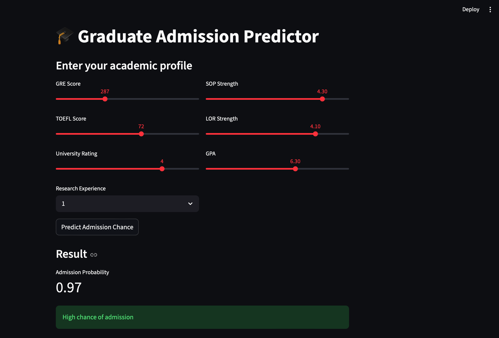

🎓 Admission Predictor (Machine Learning Project)

📌 Overview

This project predicts the probability of a student being admitted to a university based on academic and profile-related features. It uses supervised machine learning regression techniques to estimate admission chances.

The model helps students understand their chances and improve weak areas before applying for higher studies.

⸻

🎯 Objective

To build a predictive model that estimates Chance of Admission using features like:

* GRE Score
* TOEFL Score
* University Rating
* SOP Strength
* LOR Strength
* CGPA
* Research Experience

⸻

🧠 Machine Learning Approach

* Problem Type: Regression
* Target Variable: Chance of Admission (0 to 1)
* Algorithms Used:
    * Linear Regression
    * Ridge Regression (optional improvement)
* Evaluation Metrics:
    * R² Score
    * Mean Absolute Error (MAE)
    * Root Mean Squared Error (RMSE)

⸻

📊 Dataset

* Source: Kaggle – Graduate Admission Dataset
* Records: ~400 student profiles
* Features:
    * GRE Score (out of 340)
    * TOEFL Score (out of 120)
    * University Rating (1–5)
    * SOP Strength (1–5)
    * LOR Strength (1–5)
    * CGPA (out of 10)
    * Research (0 or 1)

⸻

⚙️ Project Workflow

1. Data Collection
2. Data Cleaning & Preprocessing
3. Exploratory Data Analysis (EDA)
4. Feature Selection
5. Model Training
6. Model Evaluation
7. Prediction System Development

⸻

📈 Model Performance

* R² Score: [0.9028](Linear Regression-best model)
* MAE: [0.0234]
* RMSE: [~0.035]

Note: Higher R² and lower error values indicate better model performance.

⸻

🛠️ Tech Stack

* Python 🐍
* Pandas & NumPy
* Scikit-learn
* Matplotlib / Seaborn
* Jupyter Notebook

📷 Application Preview



🌐 Live Demo

👉 Try the deployed app here: (https://admission-predictor-22.streamlit.app/)

⸻

🚀 How to Run the Project

### 1. Clone the repository
```
gh repo clone thamil-sivagnanam/admission-predictor
```
### 2. Install dependencies
```
pip install -r requirements.txt
```
### 3. Run Jupyter Notebook
```
jupyter notebook
```
🔮 How to Use the Model

You can input student details like:
```
sample_input = [[320, 110, 4, 4.5, 4.0, 9.0, 1]]
prediction = model.predict(sample_input)
print(prediction)
```
Output:
```
Chance of Admission: 0.82
```
📌 Key Features

* Simple and interpretable ML model
* Real-world education dataset
* Helps students evaluate admission chances
* Easily extendable for deployment (Flask / Streamlit)

⸻

📉 Known Issues / Improvements

* Model performance depends on dataset size
* Feature scaling can further improve accuracy
* Can be upgraded to ensemble models (Random Forest, XGBoost)

⸻

🚀 Future Improvements

* Deploy using Streamlit web app
* Add university-wise prediction system
* Improve accuracy with advanced ML models
* Add real-time input interface

⸻

👨‍💻 Author

Thamil
B.Tech AI & ML Student
Interested in Machine Learning, Deep Learning, and Study Abroad Applications

⸻

📜 License

This project is open-source and free to use for educational purposes.

